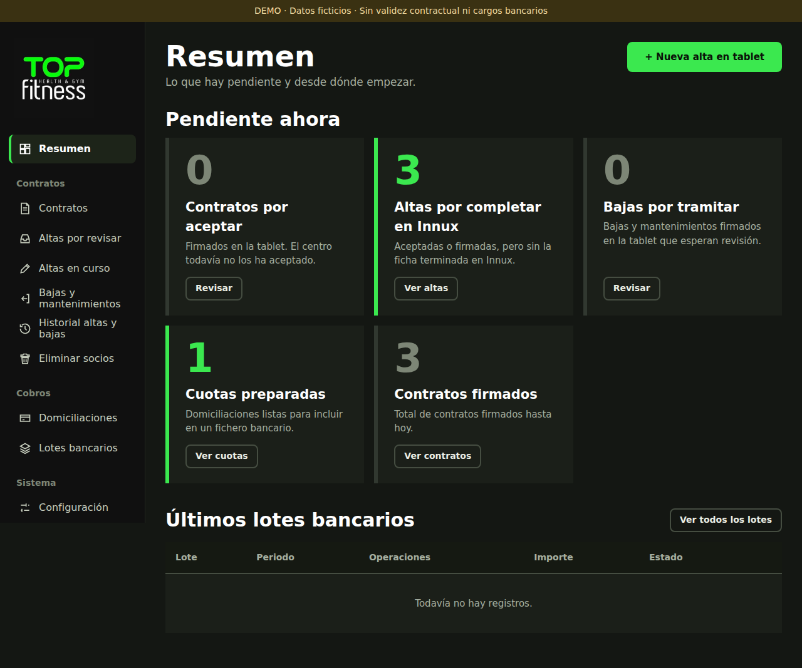
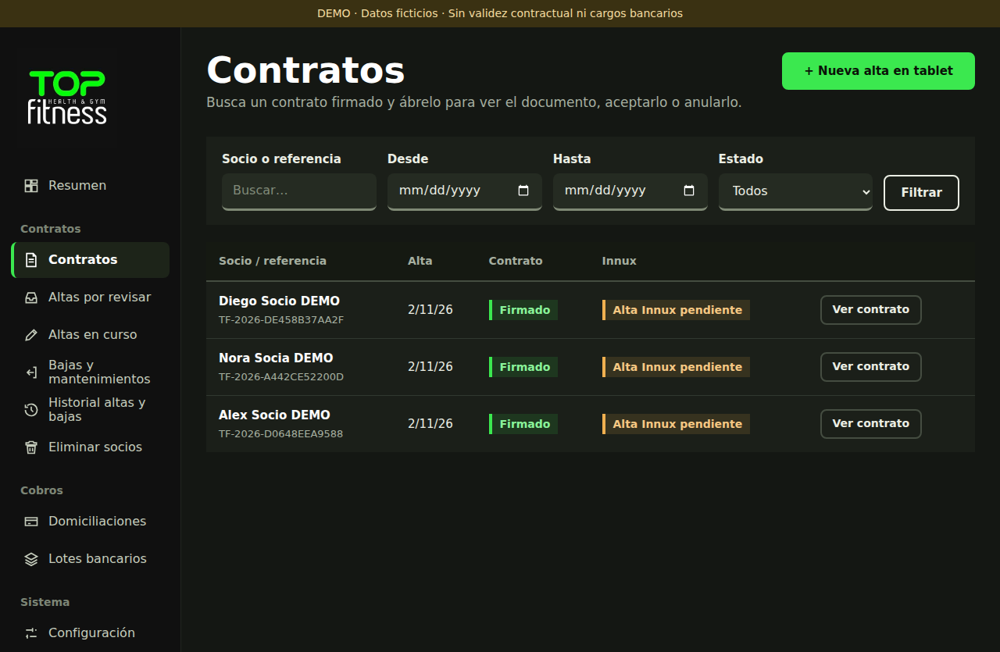
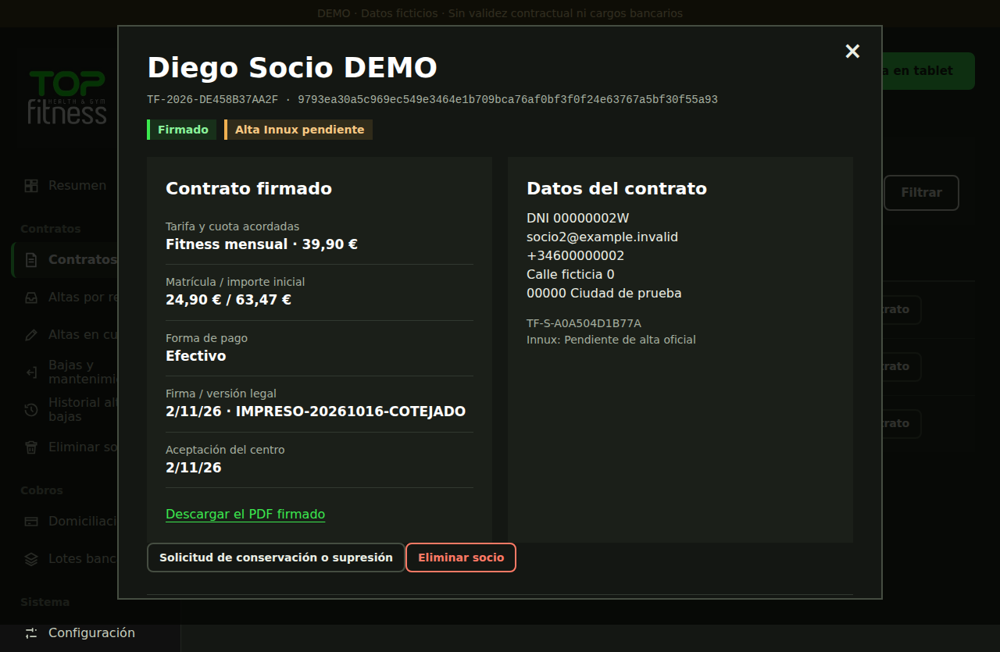
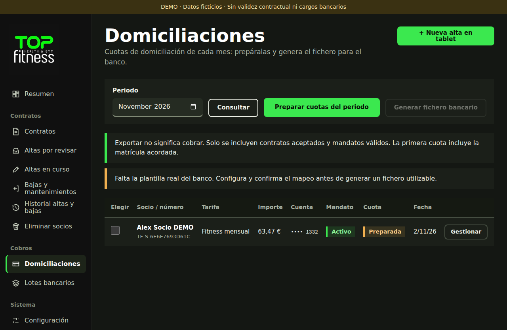
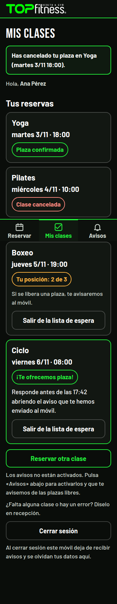
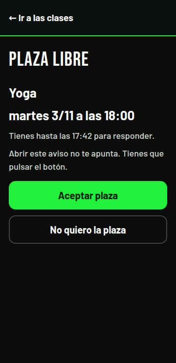
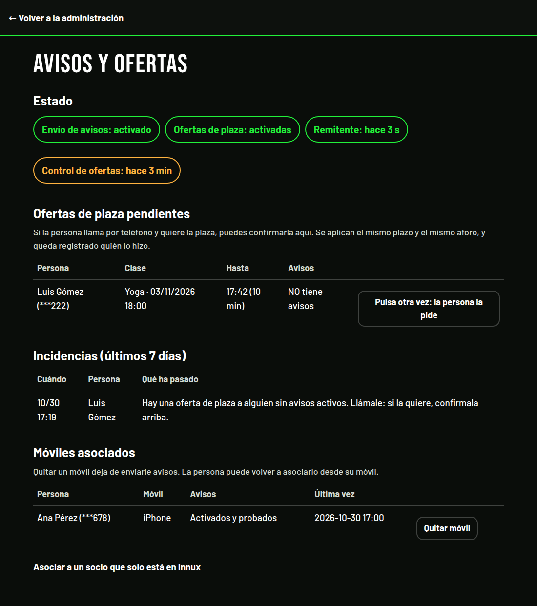

# Plataforma de gestión para un gimnasio

Sistema completo que desarrollé y mantengo en producción para un gimnasio real: altas de socios con firma en tablet, caja, reservas de clases con lista de espera, avisos push y un bot de WhatsApp. Este repositorio es una **versión anonimizada** para portafolio: sin credenciales, sin datos de socios y con dominio, IPs y correos sustituidos por valores de ejemplo.

## Capturas

Capturas de la aplicación en ejecución con **datos ficticios** (entorno de demostración y servidor de pruebas; ningún dato real).

### Altas y contratos (panel de recepción)

| Resumen | Contratos |
|---|---|
|  |  |
| **Detalle de contrato firmado** | **Domiciliaciones del mes** |
|  |  |

### Reservas en el móvil del socio (PWA)

| Reservar | Mis clases y lista de espera | Oferta de plaza liberada |
|---|---|---|
|  |  |  |

### Recepción: avisos y ofertas

## Qué resuelve

| Módulo | Descripción | Stack |
|---|---|---|
| `formulario/` | Altas de socios en tablet: datos, foto, firma, condiciones, pago (o pago pendiente), contrato en PDF, bajas y prorrateo | PHP, SQLite, JS |
| `centro-administracion/` | Panel único con login, Diario de caja, Socios y control del bot | Python, SPA en JS |
| `caja/` | Diario y cierres de caja con copia diaria automática | Python, SQLite |
| `web/` | Reservas públicas, lista de espera con ofertas, "Mis clases", avisos push (PWA) | PHP, MariaDB, Web Push |
| `bot/` | Bot de WhatsApp (Cloud API + Flows) para reservar clases | Python |
| `sistema/`, `deploy/`, `scripts/` | nginx, unidades systemd, despliegues con releases y rollback | nginx, systemd |
| `tests/`, `*/tests/` | Pruebas unitarias, de integración y end-to-end | PHPUnit-style, unittest, Playwright |

## Aspectos técnicos destacados

- **Despliegues por releases** con enlace simbólico `current`, copia previa y vuelta atrás.
- **Aislamiento y mínimo privilegio:** php-fpm propio por servicio, `NoNewPrivileges`, credenciales cifradas con `systemd-creds`, SSO con `auth_request` de nginx.
- **Concurrencia:** reserva de aforo, cola de espera y ofertas con pruebas de condiciones de carrera.
- **Numeración de socios** reservada al firmar, sin repetir números ya impresos.
- **Integración** con un sistema de control de accesos externo mediante un conector con cola de trabajos.
- **Tablet siempre disponible:** cookie persistente, latido de actividad y recuperación de token CSRF tras inactividad.
- **Datos personales:** nada de ello vive en el código; el repositorio no incluye bases de datos, exports ni PDFs de contratos.

## Qué se ha omitido o sustituido

- Credenciales, tokens, claves privadas y SSH (se configuran por variables de entorno; ver `.env.example`).
- Bases de datos, copias de seguridad, exports de socios y contratos.
- Capturas y resultados de pruebas con datos reales (las capturas incluidas son de un entorno de demostración).
- Dominio, IPs y correos de producción (sustituidos por `gimnasio.example`, `203.0.113.x` y `example.com`).

## Pruebas

- `docs/docs-altas/tests/run.sh` — prorrateo y bajas (PHP).
- `docs/docs-altas/tests/e2e/` — end-to-end con Playwright (requiere `TF_E2E_PASSWORD`).
- `bot/tests/`, `caja/tests/`, `tests/` — pruebas unitarias y de integración.

Los datos de las pruebas (nombres, teléfonos, correos) son ficticios.
