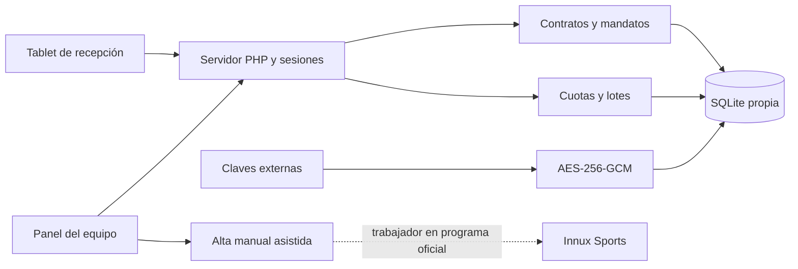

# Arquitectura técnica

## Decisión y alcance

Caja es Python/Tkinter, con SQLite local y acceso ODBC a Innux. No dispone de un servidor web ni de autenticación reutilizable para clientes. Se conserva intacta. El nuevo módulo usa PHP 8.2, SQLite local, HTML/CSS y JavaScript sin framework ni dependencias descargadas. Reutiliza el logotipo facilitado y herramientas ya instaladas. Tiene usuarios, claves, datos y servidor propios. No enlaza las bases de Caja o Innux.

El navegador consume un único controlador `public/api.php`, con acciones explícitas y permisos antes de su despacho. El servidor de desarrollo solo publica `/`, `/index.php`, `/api.php` y los recursos conocidos de `/assets/`; el directorio web es exclusivamente `public/`. Los servicios de aplicación están en `app/`, nunca publicados. Las consultas están parametrizadas. Las migraciones son incrementales y rechazan bases ajenas mediante `PRAGMA application_id`.

## Módulos

| Archivo | Responsabilidad |
| --- | --- |
| `Core.php` | Configuración, PDO, transacciones, cifrado, límites y sesión autorizada |
| `Validation.php` | Identidad, fechas, contacto, IBAN y trazos de firma |
| `Contracts.php` | Borradores, revisión vinculada por hash, firma, PDF, versiones y aceptación |
| `Pdf.php` / `Review.php` | PDF A4 con fuente incrustada y revisión accesible del mismo snapshot |
| `Mandates.php` | Firma de otro titular y cambios de cuenta mediante mandatos nuevos |
| `Billing.php` | Cuotas, correcciones, estados, vistas previas y lotes transaccionales |
| `BankFile.php` | CSV configurable y XLSX OpenXML, sin fórmulas ejecutables |
| `Admin.php` | Tarifas, usuarios, versiones legales, configuración, auditoría y copias |
| `InnuxAdapter.php` | Contrato de adaptador y alternativa manual; sin SQL ni API inventada |
| `Http.php` / `public/api.php` | Cabeceras, sesión, CSRF, autorización y respuestas sin detalles sensibles |
| `public/assets/app.js` / `admin.js` | Formulario de cinco pasos y panel administrativo |

## Modelo de datos propio

| Entidad | Contenido y relaciones |
| --- | --- |
| `users` | Usuario, hash Argon2id, rol, estado y época para revocar sesiones |
| `tariffs` | Marca, cuota, matrícula, descuento máximo, condiciones y revisión |
| `legal_versions` | Textos versionados, aprobación y referencia de revisión; textos inmutables |
| `drafts` | Datos y revisión cifrados, hash de sesión, caducidad y descuento autorizado |
| `members` | Referencia `TF-S-…`, datos cifrados, huellas HMAC para duplicados y referencia Innux opcional |
| `contracts` | Socio, tarifa, snapshot cifrado, importes acordados, firma, evidencias y PDF cifrado/hash |
| `mandates` | Socio/contrato, referencia, titular e IBAN cifrados, últimos cuatro caracteres y estado |
| `mandate_evidence` | Snapshot, firma y PDF inmutables de una autorización posterior del titular |
| `dues` | Socio/contrato/mandato, periodo, importe esperado, correcciones, fecha y estado |
| `export_profiles` | Mapeo de columnas, formato, separadores y confirmación administrativa del banco |
| `previews` | Selección cifrada de exportación, revisiones, actor, caducidad y consumo único |
| `batches` / `batch_items` | Lote, archivo cifrado/hash, responsable, total y recibos incluidos |
| `audit` | Acciones administrativas, detalle cifrado y cadena HMAC de integridad |
| `settings` | Acreedor y referencia/instrucciones de la política de conservación aprobada |
| `privacy_requests` | Solicitudes de revisión; ninguna eliminación automática de documentos |
| `email_jobs` | Intención de entrega, siempre `PROVIDER_REQUIRED` hasta integrar proveedor |
| `rate_limits` / `migrations` | Control operativo y migraciones aplicadas |

El SQL exacto está en `migrations/001_initial.sql` y `002_integrity.sql`: claves foráneas, índices, unicidad socio/periodo, recibo/lote y mandato activo/contrato. Los triggers impiden modificar o borrar el contenido firmado, modificar cuentas de un mandato y alterar la auditoría. El estado administrativo y la aceptación del centro son registros separados del contenido firmado.

## Reglas de negocio

- Los precios iniciales residen en fixtures editables y pasan al catálogo. Cada firma conserva su propia tarifa, importes, descuento y versión legal; posteriores ediciones no cambian el PDF.
- La referencia interna nunca se presenta como número de Innux. El documento normalizado se compara mediante HMAC; no se utiliza el algoritmo de DNI para pasaportes.
- La fecha la establece el servidor, con presentación en horario de Madrid y día-mes-año. Las evidencias técnicas utilizan UTC.
- El cliente revisa una versión congelada. Cambiar datos o autorizar un descuento invalida esa revisión; la firma exige el hash vigente y confirmación expresa.
- La firma guarda únicamente trazos visuales normalizados, sin presión, tiempos de puntos ni algoritmo de identificación biométrica. No se declara firma cualificada. El procedimiento y sus evidencias requieren aprobación del responsable.
- La aceptación del centro se registra con usuario, fecha y hash del PDF. El PDF original sigue indicando que la aceptación se conserva en el registro; no se reescribe para añadir un sello.
- Un titular diferente deja el mandato en `PENDING_HOLDER`. Su pantalla de firma muestra su autorización y los datos mínimos del socio, sin documento de identidad ni contacto del socio.
- Cambiar la cuenta crea un mandato nuevo. La firma activa el nuevo y revoca el anterior en una transacción; las cuotas preparadas pasan al nuevo mandato. Se bloquea el cambio si hay recibos exportados o enviados en curso.
- Solo se preparan cuotas de contratos firmados y aceptados, con mandato activo; nunca de periodos anteriores al contrato. La primera cuota incluye mensualidad y matrícula acordadas; las siguientes, la mensualidad. No hay prorrateos o calendarios de cobro inventados.
- Una versión posterior aceptada sustituye a la anterior para nuevas preparaciones. Antes de aceptarla deben resolverse sus cuotas preparadas/exportadas/enviadas. Las unicidades de periodo impiden volver a facturar automáticamente un periodo ya registrado, incluso si se canceló; las excepciones requieren revisión financiera.
- Exportar requiere un perfil confirmado, selección sin duplicados, vista previa del mismo actor y confirmación. Al generar se vuelven a comprobar revisiones, importes y mandatos dentro de `BEGIN IMMEDIATE`.
- Los estados de cuota son `PREPARED → EXPORTED → SENT → CONFIRMED`, con incidencias `RETURNED` y `CANCELLED` según las transiciones autorizadas. Enviar y confirmar son anotaciones humanas con referencia externa; no hay conexión bancaria. El estado del lote registra que fue generado; los estados de cobro se consultan por cuota.
- Un recibo incluido en un lote no se vuelve a exportar. Una devolución/corrección posterior queda como incidencia; no se retransmite automáticamente al banco.

## Permisos comprobados en backend

| Rol | Acceso |
| --- | --- |
| Administrador | Todas las operaciones del módulo |
| Recepción (`staff`) | Contratos, aceptación/anulación/versiones, descuentos permitidos, alta asistida y firma de titulares |
| Finanzas (`finance`) | Cuotas, perfiles disponibles, exportaciones, incidencias y firma de titulares; sin administración de usuarios |
| Consulta (`viewer`) | Listado, detalle y PDF de contratos, sin modificaciones |
| Cliente en recepción | Solo su borrador y su documento recién firmado; sin panel ni exportaciones |

`kiosk_start`, `new_version` y `begin_holder` retiran la sesión administrativa del dispositivo. Una segunda tablet no puede recuperar el borrador o PDF de la primera. La pantalla completa es únicamente una comodidad. No se almacena información personal o bancaria en localStorage.

## Seguridad y límites conocidos

AES-256-GCM autentica los datos personales, bancarios, firmas, evidencias, PDF y ficheros de exportación. Hay claves distintas para cifrado, búsquedas HMAC, auditoría y copias; se guardan fuera del código y de SQLite. Los datos operativos mínimos —estados, referencias, precios, últimos cuatro caracteres— son consultables sin descifrar. El acreedor y los textos legales no son un almacén de cuentas de socios.

Sesiones HttpOnly/SameSite Strict, cookies Secure y HTTPS obligatorios en producción; CSRF en POST, comprobación de origen, autorización por rol, renovación de identificador, límites por IP/usuario/sesión, CSP, no-store y validación del servidor. Las respuestas de error no incluyen SQL, contraseñas ni IBAN. La auditoría cifra los motivos libres y no devuelve sus contenidos al listado.

SQLite es para una instalación con disco local y un volumen de recepción moderado. No alojarla en SMB/Y: ni compartir el archivo entre servidores. No se ha efectuado una prueba de carga de cientos de usuarios. El PDF admite la cobertura Unicode BMP de la fuente configurada y rechaza caracteres no representables; escrituras que requieran composición compleja deben validarse o requerir otro motor antes de uso real. La fuente no se distribuye en el ZIP.

No hay servicio externo de analítica, IA, firma, correo o almacenamiento activado. La consulta de documentación de Innux no acredita una API de altas ni una importación compatible; véase la auditoría y sus enlaces oficiales.
